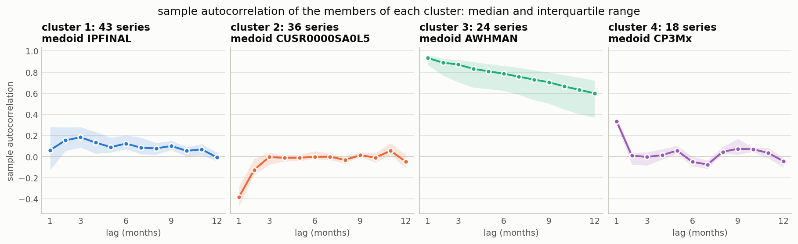

# arimaclust

[](https://codecov.io/gh/garikdza/arimaclust)
[](pyproject.toml)
[](LICENSE)

arimaclust is a Python library for model-based time series clustering.

<p align="center">
  
</p>
<p align="center"><sub>AMI against series length on four synthetic three-cluster sets of separation δ, the smallest
Piccolo distance between the generating processes.</sub></p>

## Features

**Distances** between fitted invertible models, on the first `tau` AR(∞) coefficients (`ARMADistance(metric=...)`):

| `metric` | distance | reference |
|---|---|---|
| `'piccolo'` (default) | Euclidean distance between the π-weights | [Piccolo (1990)](https://doi.org/10.1111/j.1467-9892.1990.tb00048.x) |
| `'cepstral'` | Euclidean distance between the LPC cepstral coefficients | [Kalpakis et al. (2001)](https://doi.org/10.1109/ICDM.2001.989529) |
| `'mahalanobis'` | Wald statistic on the π-weights, weighted by their estimated covariance | [Maharaj (1996)](https://doi.org/10.1080/00949659608811737) |

**Clustering** on the distance matrix:

- `ConsistentClustering(n_clusters)`: farthest-point initialisation and nearest-centre assignment
  ([Khaleghi et al., 2016](https://www.jmlr.org/papers/v17/khaleghi16a.html)). With the Piccolo distance and BIC
  order selection it is weakly asymptotically consistent for ARMA processes
  ([Adamyan, 2023](https://doi.org/10.3103/S1068362323030020)).
- `KMedoids(n_clusters)`: k-medoids, starting from PAM BUILD (`init='build'`) or from the farthest-point centres
  (`init='farthest'`), then PAM swaps until no exchange of a medoid lowers the total distance to the medoids
  ([Kaufman & Rousseeuw, 1990](https://doi.org/10.1002/9780470316801)). It often places centres better on real data,
  but has no consistency guarantee.
- `ThresholdClustering(alpha)`: connected components of the graph linking pairs at distance ≤ `alpha`, for an
  unknown number of clusters.

All are scikit-learn estimators. The clusterers fit an `ARMADistance` on raw series, or take `distance='precomputed'`.
Input is a list of 1-D arrays (lengths may differ), a 2-D array with one series per row, or a DataFrame with one series
per column. `d` sets the differencing order (`None` selects it per series); the factor (1 − B)^d is kept in the
AR(∞) representation, so series with different `d` stay apart. `arimaclust.data` simulates labelled ARMA clusters.

## Install

```bash
pip install git+https://github.com/garikdza/arimaclust
```

## Quickstart

```python
from arimaclust import ARMADistance, KMedoids
from arimaclust.data import generate_clusters

# one (AR, MA) coefficient pair per cluster: an AR(1), an AR(2) and an MA(1)
params = [([-0.6], []), ([-0.2, 0.7], []), ([], [0.2])]
X, y = generate_clusters(params, length=500, n_per_cluster=20, random_state=0)
distance = ARMADistance(max_p=3, max_q=3, d=0, metric='piccolo', tau=50, n_jobs=-1)
```

From raw series, the clusterer fits the distance itself:

```python
model = KMedoids(n_clusters=3, distance=distance).fit(X)
model.labels_                  # cluster per series
model.distance_.models_        # fitted ARIMA per series
model.distance_.dist_matrix_   # pairwise Piccolo distances
```

From a precomputed distance matrix, for example to try several clusterers on one set of fits:

```python
D = distance.fit_transform(X)  # (60, 60) Piccolo distances
labels = KMedoids(n_clusters=3, distance='precomputed').fit_predict(D)
```

## Examples

[`examples/fred_md/`](examples/fred_md) clusters 121 monthly US macroeconomic series from McCracken and Ng's FRED-MD
into four clusters, with the cepstral distance and `KMedoids`. The clusters match the eight FRED-MD topic groups only
in part (AMI 0.50): they follow how each series was made stationary more than its topic.

<p align="center">
  
</p>
<p align="center"><sub>Sample autocorrelation of the members of each FRED-MD cluster at lags 1 to 12: the median and
the interquartile band.</sub></p>

[`examples/synthetic/`](examples/synthetic) evaluates the method on simulated sets with a controlled separation δ:
how accuracy grows with series length and δ, and how well the distance is estimated.

```bash
uv sync --extra examples
uv run --extra examples python examples/fred_md/clusters.py               # downloads the data the first time
uv run --extra examples python examples/synthetic/accuracy_vs_length.py   # also accuracy_vs_delta.py, distance_estimation.py, ...
```

Each script saves its fits as `figures/<script>.npz` in its folder; `--recompute` refits.

## Citation

G. Adamyan, "Weakly consistent offline clustering of ARMA processes", *Journal of Contemporary Mathematical
Analysis*, 58(3), 183–190, 2023. https://doi.org/10.3103/S1068362323030020 (open copy in *Izvestiya NAN Armenii*:
https://arar.sci.am//Content/359562/3-13.pdf)

## References

- G. Adamyan, "Model-based time series clustering", PhD thesis, Yerevan State University, 2023.
  https://www.ysu.am/en/councils/dissertations/52425
- D. Piccolo, "A distance measure for classifying ARIMA models", *Journal of Time Series Analysis*, 11(2),
  153–164, 1990. https://doi.org/10.1111/j.1467-9892.1990.tb00048.x
- K. Kalpakis, D. Gada, V. Puttagunta, "Distance measures for effective clustering of ARIMA time-series",
  *Proceedings of the 2001 IEEE International Conference on Data Mining*, 273–280, 2001.
  https://doi.org/10.1109/ICDM.2001.989529
- E. A. Maharaj, "A significance test for classifying ARMA models", *Journal of Statistical Computation and
  Simulation*, 54(4), 305–331, 1996. https://doi.org/10.1080/00949659608811737
- A. Khaleghi, D. Ryabko, J. Mary, P. Preux, "Consistent algorithms for clustering time series", *Journal of
  Machine Learning Research*, 17(3), 1–32, 2016. https://www.jmlr.org/papers/v17/khaleghi16a.html
- M. Corduas, D. Piccolo, "Time series clustering and classification by the autoregressive metric",
  *Computational Statistics & Data Analysis*, 52(4), 1860–1872, 2008. https://doi.org/10.1016/j.csda.2007.06.001
- J.-M. Bardet, K. Kamila, W. Kengne, "Consistent model selection criteria and goodness-of-fit test for common
  time series models", *Electronic Journal of Statistics*, 14(1), 2009–2052, 2020. https://doi.org/10.1214/20-EJS1709

## License

Released under the [MIT License](LICENSE), © 2023 [garikdza](https://github.com/garikdza).
