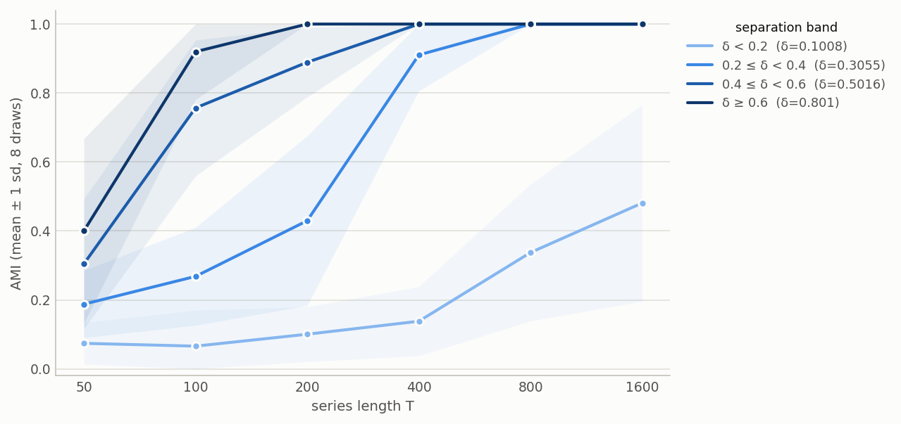
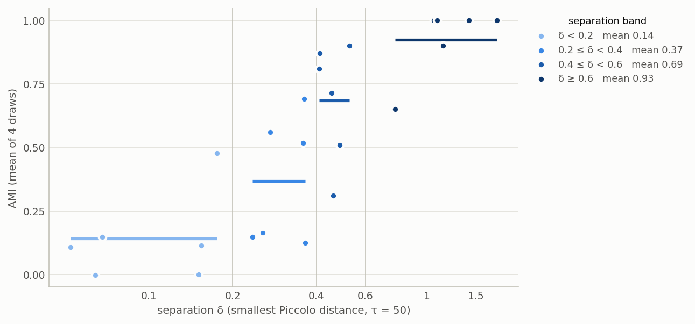

# arimaclust: consistent clustering of ARIMA time series

[](https://codecov.io/gh/garikdza/arimaclust)

Each series gets an ARMA model, selected by BIC with `pmdarima.auto_arima`. Series are compared through the
[Piccolo (1990)](https://doi.org/10.1111/j.1467-9892.1990.tb00048.x) AR distance: the Euclidean distance between
the AR(∞) coefficients of the fitted models. They are then clustered with farthest-point initialisation and
nearest-centre assignment ([Khaleghi et al., JMLR 2016](https://www.jmlr.org/papers/v17/khaleghi16a.html)). When
the maximum orders and the number of clusters are known, this procedure is weakly asymptotically consistent
(Adamyan, *Journal of Contemporary Mathematical Analysis* 58(3), 2023).

<p align="center">
  
</p>
<p align="center"><sub>Clustering accuracy (AMI) against series length for four curated three-cluster sets, from the
closest (δ &lt; 0.2) to the furthest apart (δ ≥ 0.6): accuracy goes to 1 as the series grow, sooner when the
processes are further apart. See <a href="#examples">Examples</a>.</sub></p>

## Install

```bash
uv sync
```

## Quickstart

```python
from arimaclust import ARMADistance, ConsistentClustering
from arimaclust.data.generate import generate_clusters

# one (AR coefficients, MA coefficients) pair per cluster: an AR(1), an AR(2) and an MA(1)
params = [([-0.6], []), ([-0.2, 0.7], []), ([], [0.2])]
X, y = generate_clusters(params=params, t_min=500, samples_per_cluster=20)
model = ConsistentClustering(n_clusters=len(params),
                             distance=ARMADistance(max_p=3, max_q=3, d=0, tau=10, n_jobs=-1)).fit(X)
model.labels_                  # cluster per series
model.distance_.dist_matrix_   # pairwise Piccolo distances
```

The public API is what `arimaclust` exports at the top level: `ARMADistance`, `ConsistentClustering` and
`ThresholdClustering`, all scikit-learn estimators. Other modules, including the `arimaclust.data` generators used
above, are internal. A series collection can be a list of 1-D arrays (lengths may differ), a 2D array with one series
per row, or a DataFrame with one series per column (NaNs are dropped). Pass `distance='precomputed'` to
cluster a ready distance matrix instead.

## Examples

The `examples/` scripts run the method on synthetic clusters with a known separation δ: the smallest Piccolo
distance (`tau=50`) between the ARMA processes that generate the clusters.

In the figure at the top, each point is the mean adjusted mutual information (AMI) over eight draws of three
clusters with ten series each, and the shaded band is ±1 standard deviation. The δ ≥ 0.6 set is clustered perfectly
from T = 200, and the two middle sets reach an AMI of 0.98 or more by T = 800. The δ < 0.2 set reaches only about
0.55 at T = 1600: its models are close enough that much longer series are needed to tell them apart.



At a fixed length, T = 200, accuracy rises with δ. Each dot is one generated two-cluster set (mean AMI of four
draws), and each bar is the mean of its band.

The scripts need matplotlib, from the `examples` extra, and write their figures to `examples/figures/`. The
slowest, `accuracy_vs_length.py`, fits about 6,000 models and takes several minutes on a multi-core machine.
The four scripts that fit models save their raw results next to the figures, as `examples/figures/<script>.npz`, and
later runs redraw the figures from that file in seconds. Pass `--recompute` to fit again, for example after changing
a script's settings or a curated set.

```bash
uv sync --extra examples
uv run --extra examples python examples/accuracy_vs_length.py   # accuracy_vs_length.png (the figure at the top)
uv run --extra examples python examples/accuracy_vs_delta.py    # accuracy_vs_delta.png: accuracy against δ
uv run --extra examples python examples/distance_matrix.py      # distance_matrix.png: heatmap and MDS embedding
uv run --extra examples python examples/distance_estimation.py  # estimated_distance.png: fitted vs true δ
uv run --extra examples python examples/processes.py            # sample_series.png, ar_coefficients.png
```

`examples/synthetic.py` holds the curated cluster sets, one per δ band, and `generate_separated_params`, which
draws new sets with a given δ.

## Citation

If you use arimaclust, please cite:

G. Adamyan, "Weakly consistent offline clustering of ARMA processes", *Journal of Contemporary Mathematical
Analysis*, 58(3), 183–190, 2023. https://doi.org/10.3103/S1068362323030020

## References

- G. Adamyan, "Model-based time series clustering", PhD thesis, Yerevan State University, 2023.
  https://www.ysu.am/en/councils/dissertations/52425
- G. Adamyan, "Model-based clustering of foreign exchange market", *Proceedings of the Engineering Academy of
  Armenia*, 20(1), 24–33, 2023.
- D. Piccolo, "A distance measure for classifying ARIMA models", *Journal of Time Series Analysis*, 11(2),
  153–164, 1990. https://doi.org/10.1111/j.1467-9892.1990.tb00048.x
- M. Corduas, D. Piccolo, "Time series clustering and classification by the autoregressive metric",
  *Computational Statistics & Data Analysis*, 52(4), 1860–1872, 2008. https://doi.org/10.1016/j.csda.2007.06.001
- A. Khaleghi, D. Ryabko, J. Mary, P. Preux, "Consistent algorithms for clustering time series", *Journal of
  Machine Learning Research*, 17(3), 1–32, 2016. https://www.jmlr.org/papers/v17/khaleghi16a.html
- J.-M. Bardet, K. Kamila, W. Kengne, "Consistent model selection criteria and goodness-of-fit test for common
  time series models", *Electronic Journal of Statistics*, 14(1), 2009–2052, 2020. https://doi.org/10.1214/20-EJS1709

## License

MIT
