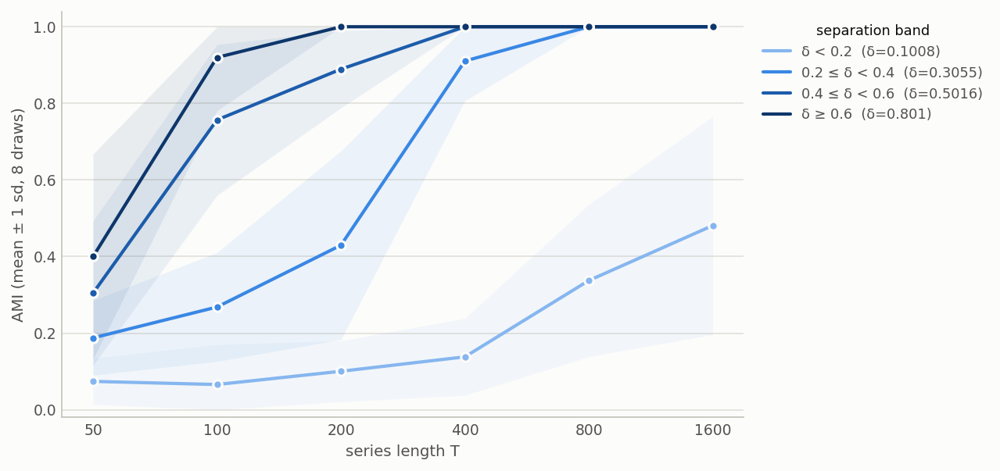
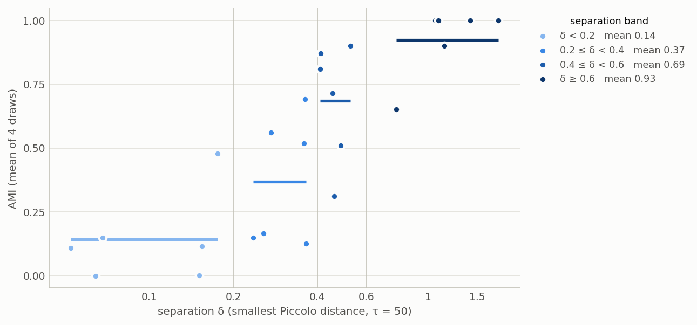

# Theory: why the clustering is consistent

This page sets out the assumptions under which arimaclust's procedure recovers the true clusters, and why. It
follows Adamyan (2023), where the proofs are, and the PhD thesis built on it. The procedure is: fit an ARMA model to
each series with orders chosen by BIC, compute the Piccolo distance between every pair of fitted models, and cluster
the distance matrix by farthest-point initialisation and nearest-centre assignment (`ConsistentClustering`).

## Setting and assumptions

A process $X = (X_t)$ is ARMA(p, q) if it is stationary and

```math
X_t = \varepsilon_t + \sum_{i=1}^{p} \phi_i X_{t-i} + \sum_{j=1}^{q} \theta_j \varepsilon_{t-j},
\qquad\text{that is}\qquad \phi(B) X_t = \theta(B) \varepsilon_t,
```

where $B$ is the lag operator, $\phi(B) = 1 - \phi_1 B - \dots - \phi_p B^p$,
$\theta(B) = 1 + \theta_1 B + \dots + \theta_q B^q$, the two polynomials have no common factor, and
$\varepsilon_t$ is Gaussian white noise.

The data set is $N$ series $x_1, \dots, x_N$, possibly of different lengths $n_1, \dots, n_N$. Each series is a
sample of one of $\kappa < N$ unknown ARMA processes $X^{(1)}, \dots, X^{(\kappa)}$, and the ground truth $G$ is the
partition of the series by the process that generated them. Two processes count as the same cluster when they have
the same forecast function $E[X_t \mid X_{t-1}, X_{t-2}, \dots]$.

The results below assume that:

- every process is stationary and invertible (defined in the next section);
- the maximum orders $(p_{\max}, q_{\max})$ of the processes are known: in `ARMADistance` these are `max_p` and
  `max_q`, the largest orders `auto_arima` may choose;
- the number of clusters $\kappa$ is known: `n_clusters` in `ConsistentClustering`.

Consistency is a statement about long series. With $n = \min_i n_i$ and $f(D, \kappa)$ the partition the algorithm
returns, the algorithm is **weakly asymptotically consistent** if

```math
\lim_{n \to \infty} P\bigl(f(D, \kappa) = G\bigr) = 1,
```

and **strongly asymptotically consistent** if, with probability 1, $f(D, \kappa) = G$ for every $n$ beyond some
finite $n'$.

## The AR(∞) representation

$X$ is **invertible** when $\theta(z) \ne 0$ for all complex $|z| \le 1$, that is, when every root of the MA
polynomial lies outside the unit circle. Then $1/\theta(z)$ has a power series that converges on a disc of radius
greater than 1, and the shocks can be written in terms of the past of $X$:

```math
\pi(B) X_t = \varepsilon_t, \qquad
\pi(B) = \frac{\phi(B)}{\theta(B)} = 1 - \sum_{j=1}^{\infty} \pi_j B^j .
```

So $X_t = \sum_{j \ge 1} \pi_j X_{t-j} + \varepsilon_t$: an autoregression of infinite order. The weights
$\pi_1, \pi_2, \dots$ determine the forecast function, so two invertible processes forecast alike exactly when their
weights agree.

The weights follow from matching powers of $B$ in $\phi(B) = \theta(B)\pi(B)$. With $\pi_0 := -1$,
$\phi_j := 0$ for $j > p$ and $\pi_j := 0$ for $j < 0$, the coefficient of $B^j$ gives, for $j \ge 1$,

```math
\pi_j = \phi_j - \sum_{k=1}^{\min(j,\, q)} \theta_k \, \pi_{j-k} .
```

For example, the ARMA(2, 1) with $\phi = (0.5, -0.2)$ and $\theta = (0.4)$ has
$\pi_1 = 0.5 + 0.4 = 0.9$, $\pi_2 = -0.2 - 0.4 \cdot 0.9 = -0.56$, $\pi_3 = 0.224$, $\pi_4 = -0.0896$, and so on.

Because the roots of $\theta$ lie outside the unit circle, the weights decay geometrically: $|\pi_j| \le C r^j$ for
some $C$ and some $r < 1$. Sources differ in the sign they give the $\pi_j$ (statsmodels' `ArmaProcess.arma2ar`
returns the coefficients of $\pi(B)$, that is $1, -\pi_1, -\pi_2, \dots$). The distance below is the same either way.

## The Piccolo distance and its truncation

Piccolo (1990) compares two invertible processes through their AR(∞) weights:

```math
d_{\mathrm{PIC}}\bigl(X^{(1)}, X^{(2)}\bigr) = \Bigl( \sum_{j=1}^{\infty} \bigl(\pi^{(1)}_j - \pi^{(2)}_j\bigr)^2 \Bigr)^{1/2} .
```

It is defined for any orders and parameters, and it is 0 exactly when the two processes have the same forecast
function. Its estimate between two series replaces the true weights by those of the fitted models and truncates
the sum at $\tau$:

```math
\hat d_{\mathrm{PIC}}(x_1, x_2) = \Bigl( \sum_{j=1}^{\tau} \bigl(\hat\pi^{(1)}_j - \hat\pi^{(2)}_j\bigr)^2 \Bigr)^{1/2} .
```

For a non-stationary series fitted as ARIMA(p, d, q), `ARMADistance` uses the weights of
$\pi(B) = \phi(B)(1 - B)^d / \theta(B)$, the AR(∞) form of the ARIMA model; they still decay geometrically once
the MA polynomial is invertible. The results below are stated for stationary ARMA processes, that is $d = 0$.

In the theory $\tau = \tau_n$ grows to infinity with the series length. The code uses a fixed `tau` (default 50), so
it compares the first `tau` weights. Since the weights decay geometrically, the omitted tail is small for an
invertible model, but the consistency results are stated for $\tau_n \to \infty$.

## Estimating the distance, and why BIC

The estimate $\hat d_{\mathrm{PIC}}$ is only as good as the fitted models, and the orders have to be estimated too.
For each series, Algorithm 1 of the paper picks the orders and parameters by minimising the BIC-penalised
quasi-likelihood over all orders up to $(p_{\max}, q_{\max})$:

```math
(\hat m, \hat\beta) = \arg\min_{m = (p, q),\ \beta}
\Bigl( -2 \hat L_n(\beta) + (p + q) \log n \Bigr).
```

**Theorem 3.1** of the paper, from the results of Bardet, Kamila and Kengne (2020): if the true order
$m^\ast = (p^\ast, q^\ast)$ is among the candidates, then under standard regularity conditions this estimator is
consistent, $P(\hat m = m^\ast) \to 1$ and $\hat\beta \to \beta^\ast$ in probability as $n \to \infty$.

**Proposition 3.1** of the paper (Proposition 3.1.4 of the thesis): if the maximum orders are known, then
$\hat d_{\mathrm{PIC}}(x_1, x_2) \to d_{\mathrm{PIC}}(X^{(1)}, X^{(2)})$ in probability. This follows from
Theorem 3.1 by the continuous mapping theorem. When the orders themselves are known, the estimate converges almost
surely (Proposition 3.1.3 of the thesis).

The penalty matters. Bardet et al. study criteria of the form $-2\hat L_n(m) + |m| c_n$, where $|m|$ is the
number of parameters: $c_n = 2$ is AIC and $c_n = \log n$ is BIC. For ARMA models, any penalty with
$c_n \to \infty$ and $c_n / n \to 0$ selects the true orders consistently, so BIC's $\log n$ qualifies. AIC's fixed
penalty does not satisfy the first condition, and criteria that fail it can overestimate the orders with positive
probability (Hannan 1980).
For the wider class Bardet et al. cover, which includes for example AR models with ARCH(∞) errors, BIC is not always
consistent, which is why the results here are stated for ARMA. `ARMADistance` selects by BIC for this reason.

The search itself differs from the theorem in one respect. By default `auto_arima` searches the orders stepwise,
from (2, 2) to neighbouring orders, instead of over all of them. On the curated example processes, at lengths 100
to 1600, stepwise missed the lowest BIC in 2 fits out of 360, all at length 100, and was about three times faster.
`arima_kwargs={'stepwise': False, 'max_order': None}` runs the full search; without `max_order=None`, pmdarima
skips orders with p + q > 5.

## The consistency theorems

The clustering step is the offline algorithm of Khaleghi et al. (2016), with their distributional distance replaced
by $\hat d_{\mathrm{PIC}}$. The first centre is series 1; each next centre is the series farthest from the centres
chosen so far; then every series joins its nearest centre. `ConsistentClustering` implements it.

**Theorem 3.1.1** of the thesis (strong consistency): if the orders of all the processes are the same and known, and
$\kappa$ is known, the algorithm is strongly asymptotically consistent.

**Theorem 3.2** of the paper (Theorem 3.1.2 of the thesis, weak consistency): if the maximum orders
$(p_{\max}, q_{\max})$ and $\kappa$ are known, the algorithm is weakly asymptotically consistent. Moreover, for every
$\eta \in (0, 1)$ there is an $n$ such that, if $n_{\min} = \min_i n_i > n$,

```math
P\bigl(f(D, \kappa) = G\bigr) \ \ge\ \bigl(1 - (N - \kappa)(4 - 4\eta)\bigr)\,(4\eta - 3)^{\kappa - 1}.
```

The idea of the proof: fix $\varepsilon < \delta / 4$. Once the series are long enough, every estimated distance
within a cluster is below $2\varepsilon$ with probability at least $2\eta - 1$, and every distance between
clusters is above $\delta - 2\varepsilon$ with probability at least $2\eta - 1$. Then each farthest-point step picks its centre from a
new cluster with probability at least $4\eta - 3$, and every series is nearer its own cluster's centre than any
other.

`ConsistentClustering` uses `ARMADistance`'s defaults (`max_p=3`, `max_q=3`, BIC) unless told otherwise, so the
known-maximum-orders assumption holds when `max_p` and `max_q` are at least the true orders. The thesis states
Proposition 3.1.4 and Theorem 3.1.2 with orders strictly below $P_{\max}$ and $Q_{\max}$; the paper states them with
the maximum orders known.

## The separation δ

The proof depends on how far apart the processes are. The separation

```math
\delta = \min_{k \ne k'} d_{\mathrm{PIC}}\bigl(X^{(k)}, X^{(k')}\bigr)
```

is the smallest distance between two of the generating processes. The proof needs every estimated distance to be
within $\varepsilon < \delta / 4$ of its true value. The smaller $\delta$, the smaller $\varepsilon$ must be, and so
the longer the series must be before the bound above applies. δ does not appear in the bound itself; it sets how
large $n$ must be. The synthetic examples show this effect.

<p align="center">
  
</p>

Clustering accuracy (AMI) against series length for four three-cluster sets, from the closest (δ < 0.2) to the
furthest apart (δ ≥ 0.6): accuracy goes to 1 as the series grow, sooner when the processes are further apart.

<p align="center">
  
</p>

At a fixed length of 200, accuracy rises with δ across generated two-cluster sets, with a wide spread within each
band: δ is not the only thing that makes two processes hard to tell apart from short series.

## References

- G. Adamyan, "Weakly consistent offline clustering of ARMA processes", *Journal of Contemporary Mathematical
  Analysis*, 58(3), 183–190, 2023. https://doi.org/10.3103/S1068362323030020 (open copy in *Izvestiya NAN
  Armenii*: https://arar.sci.am//Content/359562/3-13.pdf)
- G. Adamyan, "Model-based time series clustering", PhD thesis, Yerevan State University, 2023.
  https://www.ysu.am/en/councils/dissertations/52425 (synopsis:
  https://www.ysu.am/sites/default/files/2023-11/synopsis_GA_signed_final_date.pdf)
- D. Piccolo, "A distance measure for classifying ARIMA models", *Journal of Time Series Analysis*, 11(2),
  153–164, 1990. https://doi.org/10.1111/j.1467-9892.1990.tb00048.x
- A. Khaleghi, D. Ryabko, J. Mary, P. Preux, "Consistent algorithms for clustering time series", *Journal of
  Machine Learning Research*, 17(3), 1–32, 2016. https://www.jmlr.org/papers/v17/khaleghi16a.html
- J.-M. Bardet, K. Kamila, W. Kengne, "Consistent model selection criteria and goodness-of-fit test for common
  time series models", *Electronic Journal of Statistics*, 14(1), 2009–2052, 2020. https://doi.org/10.1214/20-EJS1709
- E. J. Hannan, "The estimation of the order of an ARMA process", *Annals of Statistics*, 8(5), 1071–1081, 1980.
  https://doi.org/10.1214/aos/1176345144
