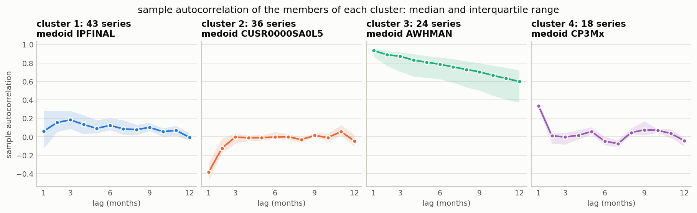
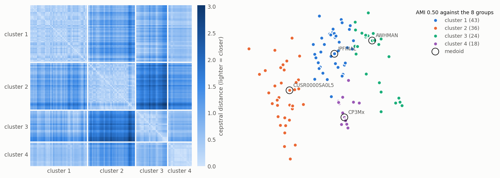

# FRED-MD: clustering US macroeconomic series

This example clusters 121 monthly US macroeconomic series from FRED-MD by the dynamics of their fitted ARMA models.
Each series gets an ARMA model selected by BIC, the models are compared by the cepstral distance, and k-medoids splits
them into four clusters. FRED-MD sorts its series into eight topic groups (output, labour market, prices and so on).
The clusters agree with those groups only in part: they follow how each series was made stationary more than its
topic.

## Data

[FRED-MD](https://www.stlouisfed.org/research/economists/mccracken/fred-databases) is McCracken and Ng's monthly
database of US macroeconomic series, maintained by the Federal Reserve Bank of St. Louis. The example uses the
January 2026 vintage:

```
https://www.stlouisfed.org/-/media/project/frbstl/stlouisfed/research/fred-md/monthly/2026-01-md.csv
```

The vintage is fixed, so later data revisions don't change the result. The download needs no API key. The first run
saves it to `data/2026-01-md.csv` and later runs read it from there. The `data/` folder is not tracked by git.

## Preprocessing

- **Transformations.** Row 2 of the file gives each series' transformation code, which makes it stationary. The
  example applies these codes as published:

  | code | transformation | series, of the 121 kept |
  |---|---|---|
  | 1 | level x | 10 |
  | 2 | first difference Δx | 18 |
  | 3 | second difference Δ²x | 0 |
  | 4 | log x | 10 |
  | 5 | log difference Δlog x | 49 |
  | 6 | second log difference Δ²log x | 33 |
  | 7 | change of the growth rate Δ(x_t / x_{t−1} − 1) | 1 |

- **Window.** The series are transformed first and then cut to 1960-01 to 2019-12, T = 720 months, so a differenced
  series' first month uses the months before the window.
- **Dropped series.** Five series have a gap in the window and are dropped: ACOGNO, ANDENOx, TWEXAFEGSMTHx,
  UMCSENTx and VIXCLSx. That leaves N = 121 series, kept in the vintage's column order. No outliers are removed.
- **Groups.** The eight FRED-MD groups come from the appendix that comes with the data. The example hard-codes them
  in `fred_md.py` because the appendix's download address carries a hash. The 121 series split into
  output and income 16, labour market 31, housing 10, consumption, orders and inventories 7, money and credit 13,
  interest and exchange rates 21, prices 20 and stock market 3.

## Settings

```python
distance = ARMADistance(max_p=3, max_q=3, d=0, metric='cepstral', tau=50, n_jobs=4)
model = KMedoids(n_clusters=4, distance=distance).fit(series)
```

`d=0` because the series are already transformed. `KMedoids` starts from PAM BUILD and runs PAM swaps until no
exchange of a medoid lowers the total distance.

## Run

```bash
uv sync --extra examples
uv run --extra examples python examples/fred_md/clusters.py
```

The first run downloads the vintage (it needs the network) and fits the 121 models in about 90 seconds. It saves
the results to `figures/clusters.npz` and later runs redraw from that file. Add `--recompute` to fit again.
`fred_md.py` holds the download, reading, transformations, window and groups. `clusters.py` fits, prints and draws.

## Results

The run prints:

```
FRED-MD 2026-01-md.csv, 1960-01 to 2019-12: T=720, N=121; dropped for a gap in the window: ACOGNO, ANDENOx, TWEXAFEGSMTHx, UMCSENTx, VIXCLSx
AMI against the 8 FRED-MD groups 0.505, silhouette 0.464
```

The AMI compares the clusters with the eight topic groups (1 means the same partition, 0 what chance would give).
The silhouette, computed on the distance matrix, measures how well each series sits in its cluster (1 is best).

| cluster | name | size | medoid | for example | transformation codes | median ACF at lags 1 / 2 / 12 |
|---|---|---|---|---|---|---|
| 1 | Real activity and jobs | 43 | IPFINAL | INDPRO, PAYEMS, UNRATE, RETAILx | tc5 35, tc2 8 | +0.06 / +0.15 / −0.00 |
| 2 | Prices, money, credit and wages | 36 | CUSR0000SA0L5 | CPIAUCSL, PCEPI, M2SL, BUSLOANS | tc6 33, tc5 2, tc7 1 | −0.38 / −0.12 / −0.05 |
| 3 | Housing, spreads and hours | 24 | AWHMAN | HOUST, PERMIT, T10YFFM, BAAFFM | tc1 10, tc4 10, tc5 4 | +0.93 / +0.89 / +0.60 |
| 4 | Interest rates, exchange rates and stocks | 18 | CP3Mx | FEDFUNDS, GS10, EXJPUSx, S&P 500 | tc2 10, tc5 8 | +0.34 / +0.01 / −0.04 |

The ACF is each member's sample autocorrelation of the transformed series. The table gives the cluster median; the
printed output adds the interquartile range. Per cluster, the run prints:

```
cluster 1: 43 series, medoid IPFINAL
  tcodes   tc5 35, tc2 8
  groups   labour market 22, output and income 14, consumption, orders and inventories 6, money and credit 1
  ACF lag 1  median +0.06  IQR [-0.13, +0.28]
  ACF lag 2  median +0.15  IQR [+0.05, +0.28]
  ACF lag 12 median -0.00  IQR [-0.04, +0.04]
  members  RPI, W875RX1, DPCERA3M086SBEA, CMRMTSPLx, RETAILx, INDPRO, IPFPNSS, IPFINAL, IPCONGD, IPDCONGD, IPNCONGD, IPBUSEQ, IPMAT, IPNMAT, IPMANSICS, IPFUELS, CUMFNS, HWI, HWIURATIO, CLF16OV, CE16OV, UNRATE, UEMPMEAN, UEMP5TO14, UEMP15OV, UEMP15T26, UEMP27OV, CLAIMSx, PAYEMS, USGOOD, CES1021000001, USCONS, DMANEMP, SRVPRD, USTPU, USWTRADE, USTRADE, USGOVT, AWOTMAN, AMDMNOx, BUSINVx, ISRATIOx, CONSPI

cluster 2: 36 series, medoid CUSR0000SA0L5
  tcodes   tc6 33, tc5 2, tc7 1
  groups   prices 20, money and credit 11, labour market 4, output and income 1
  ACF lag 1  median -0.38  IQR [-0.47, -0.28]
  ACF lag 2  median -0.12  IQR [-0.17, -0.02]
  ACF lag 12 median -0.05  IQR [-0.10, +0.02]
  members  IPB51222S, UEMPLT5, M1SL, M2SL, BOGMBASE, TOTRESNS, NONBORRES, BUSLOANS, REALLN, NONREVSL, WPSFD49207, WPSFD49502, WPSID61, WPSID62, OILPRICEx, PPICMM, CPIAUCSL, CPIAPPSL, CPITRNSL, CPIMEDSL, CUSR0000SAC, CUSR0000SAD, CUSR0000SAS, CPIULFSL, CUSR0000SA0L2, CUSR0000SA0L5, PCEPI, DDURRG3M086SBEA, DNDGRG3M086SBEA, DSERRG3M086SBEA, CES0600000008, CES2000000008, CES3000000008, DTCOLNVHFNM, DTCTHFNM, INVEST

cluster 3: 24 series, medoid AWHMAN
  tcodes   tc1 10, tc4 10, tc5 4
  groups   housing 10, interest and exchange rates 8, labour market 5, consumption, orders and inventories 1
  ACF lag 1  median +0.93  IQR [+0.87, +0.96]
  ACF lag 2  median +0.89  IQR [+0.77, +0.93]
  ACF lag 12 median +0.60  IQR [+0.37, +0.72]
  members  MANEMP, NDMANEMP, USFIRE, CES0600000007, AWHMAN, HOUST, HOUSTNE, HOUSTMW, HOUSTS, HOUSTW, PERMIT, PERMITNE, PERMITMW, PERMITS, PERMITW, AMDMUOx, COMPAPFFx, TB3SMFFM, TB6SMFFM, T1YFFM, T5YFFM, T10YFFM, AAAFFM, BAAFFM

cluster 4: 18 series, medoid CP3Mx
  tcodes   tc2 10, tc5 8
  groups   interest and exchange rates 13, stock market 3, output and income 1, money and credit 1
  ACF lag 1  median +0.34  IQR [+0.30, +0.38]
  ACF lag 2  median +0.01  IQR [-0.07, +0.04]
  ACF lag 12 median -0.04  IQR [-0.10, -0.01]
  members  IPDMAT, M2REAL, S&P 500, S&P div yield, S&P PE ratio, FEDFUNDS, CP3Mx, TB3MS, TB6MS, GS1, GS5, GS10, AAA, BAA, EXSZUSx, EXJPUSx, EXUSUKx, EXCAUSx
```

## Figures

<p align="center">
  
</p>
<p align="center"><sub>Sample autocorrelation of each cluster's members at lags 1 to 12: the median line and the
interquartile band. Cluster 1 stays near zero, cluster 2 starts at about −0.4, cluster 3 starts at about 0.9 and
decays slowly, and cluster 4 has one positive lag and nothing after it.</sub></p>

<p align="center">
  
</p>
<p align="center"><sub>Left: the cepstral distance matrix, its rows and columns ordered by cluster (lighter is
closer). Right: a 2-D multidimensional scaling of the same distances, coloured by cluster, with the four medoids
circled and named.</sub></p>

## Interpretation

Each cluster is described by what the run measures: its transformation codes, its groups and its autocorrelations.

- **Real activity and jobs (cluster 1, 43 series).** Growth rates (tc5) and differences (tc2) of output, employment,
  sales and orders: 14 of the 16 output and income series and 22 of the 31 labour market series. Their
  autocorrelation is small at every lag: the median is +0.06 at lag 1, with an interquartile range from −0.13 to
  +0.28, +0.15 at lag 2 and zero at lag 12.
- **Prices, money, credit and wages (cluster 2, 36 series).** All 33 tc6 series and the one tc7 series, plus two tc5
  series. These are the series FRED-MD differences twice in logs: all 20 price series, 11 of the 13 money and credit
  series and the three average hourly earnings series. Their median lag-1 autocorrelation is −0.38. That is
  consistent with over-differencing: differencing a stationary series once too often gives a negative lag-1
  autocorrelation and an MA root near 1.
- **Housing, spreads and hours (cluster 3, 24 series).** The series used in levels or log levels (tc1 and tc4): the
  10 housing starts and permits series, the 8 interest-rate spreads over the federal funds rate, and two average
  weekly hours series. Their autocorrelation is high and decays slowly: +0.93 at lag 1 and +0.60 at lag 12.
- **Interest rates, exchange rates and stocks (cluster 4, 18 series).** Changes in interest rates and the S&P dividend
  yield (tc2), and growth rates of exchange rates and stock prices (tc5). The autocorrelation is +0.34 at lag 1 and
  close to zero from lag 2 on. That is consistent with time averaging: the change of a monthly average of a daily random
  walk has a lag-1 autocorrelation of about 0.25 and roughly zero beyond (Working, 1960). FRED documents FEDFUNDS, GS10,
  TB3MS, CPF3M (the source of CP3Mx) and EXJPUS as monthly averages of daily data.

## Caveats

- **The clusters follow the transformation code more than the topic.** The AMI against the eight groups is 0.505.
  Each cluster's transformation codes are more uniform than its groups: cluster 2 holds every tc6 and tc7 series,
  cluster 3 every tc1 and tc4 series. Series that FRED-MD files in the same group are split by how they are
  transformed: housing joins the interest-rate spreads in cluster 3, which are also used in levels, and the labour
  market series are spread over clusters 1, 2 and 3.
- **The prices and money cluster reflects the double log-differencing.** Its shape is the one twice-differenced series
  show, so the cluster says more about the transformation chosen for these series than about inflation itself.
- **The dynamics changed after the mid-1980s.** The example fits one model per series to the whole of 1960–2019,
  so the clusters mainly reflect the earlier decades.
- **Some cluster edges are weak.**
  - Cluster 3 holds four tc5 growth rates, MANEMP, NDMANEMP, USFIRE and AMDMUOx, which are not levels like the rest.
    Its interquartile range at lag 12, +0.37 to +0.72, shows the spread.
  - Cluster 2 holds two tc5 series, UEMPLT5 and IPB51222S. They are noisy growth rates, not twice-differenced
    series.
  - Cluster 4 holds IPDMAT and M2REAL, which are neither interest rates, exchange rates nor stock prices.
  - Cluster 1 has the widest lag-1 interquartile range, −0.13 to +0.28, so its members range from slightly
    negative to clearly positive autocorrelation.

## References

- M. W. McCracken, S. Ng, "FRED-MD: A monthly database for macroeconomic research", *Journal of Business & Economic
  Statistics*, 34(4), 574–589, 2016. https://doi.org/10.1080/07350015.2015.1086655
- H. Working, "Note on the correlation of first differences of averages in a random chain", *Econometrica*, 28(4),
  916–918, 1960. https://doi.org/10.2307/1907574
