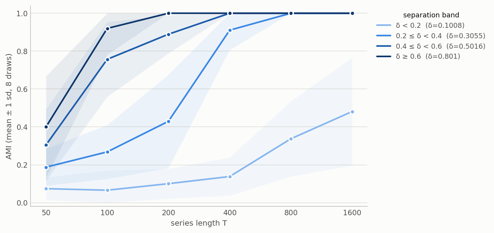
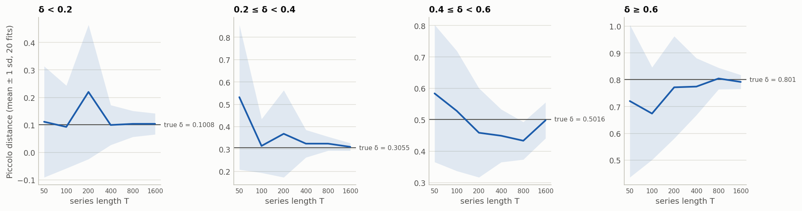
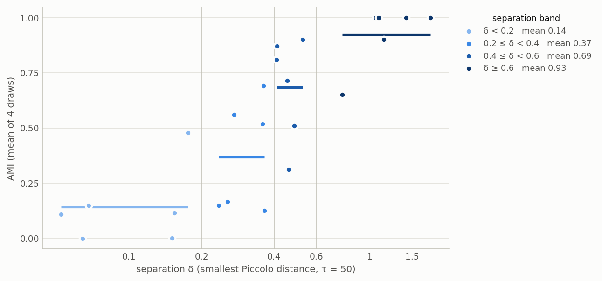

# Synthetic examples: clustering at a controlled separation

These examples run the method on simulated ARMA clusters whose difficulty is known in advance. The difficulty of a
set is its separation δ, the smallest Piccolo distance (`tau=50`) between the processes that generate its clusters.

`synthetic.py` defines the sets:

- **Four δ bands**: δ < 0.2, 0.2 ≤ δ < 0.4, 0.4 ≤ δ < 0.6 and δ ≥ 0.6.
- **Curated sets**: one three-cluster set of ARMA processes per band, with its δ recorded.
- **Random sets**: stationary, invertible ARMA(≤2, ≤2) processes drawn at random and kept while every pair is at
  least a given δ apart.

The accuracy figures cluster the series with `ConsistentClustering` on the default Piccolo `ARMADistance` and score
the result by the adjusted mutual information (AMI) with the true clusters.

## Figures

<p align="center">
  
</p>
<p align="center"><sub>AMI against series length on four synthetic three-cluster sets of separation δ, the smallest
Piccolo distance between the generating processes.</sub></p>

<p align="center">
  
</p>
<p align="center"><sub>Estimated Piccolo distance against series length for the closest pair of processes in each
curated set (mean ± 1 sd over 20 pairs); the line is the true δ.</sub></p>

<p align="center">
  
</p>
<p align="center"><sub>AMI against δ for random two-cluster sets at T = 200 (each dot a set, bars the band
means).</sub></p>

## Scripts

| script | draws |
|---|---|
| `accuracy_vs_length.py` | `figures/accuracy_vs_length.png`: AMI against series length, one curve per curated set |
| `accuracy_vs_delta.py` | `figures/accuracy_vs_delta.png`: AMI against δ on random two-cluster sets |
| `distance_estimation.py` | `figures/estimated_distance.png`: the fitted distance of each set's closest pair against length |
| `distance_matrix.py` | `figures/distance_matrix.png`: the fitted distance matrix of one curated set, as a heatmap and a 2-D MDS embedding |
| `processes.py` | `figures/sample_series.png` and `figures/ar_coefficients.png`: a sample series and the true AR(∞) coefficients of each process |

## Run

```bash
uv sync --extra examples
uv run --extra examples python examples/synthetic/accuracy_vs_length.py   # or any other script above
```

The scripts need no network. The four that fit models save their raw results as `figures/<script>.npz` and later
runs redraw from that file. Add `--recompute` to fit again after changing a script's settings or a curated set.
